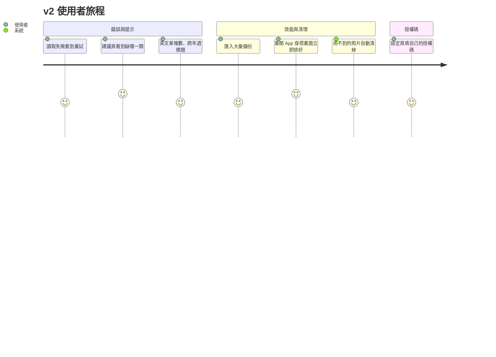

# TENKI OUTFIT v2 Implementation Plan

> **For Agent:** Execute this plan batch by batch. Follow each step exactly, verify test results before proceeding, and commit after each batch.
> **TDD Rule:** No production code without a failing test first.

**Goal:** 收掉 v1 各階段「留待之後處理」的錯誤狀態、提示、效能與清理項目，並讓使用者可改填自己的氣象署授權碼，發布 v1.1.0。
**Architecture:** 不改資料庫結構（沒有遷移）、不改備份格式。錯誤狀態集中在共用的查詢 hook；照片範圍改存在 App 資料夾的 JSON 快取檔；清理工作都在 App 啟動（以及回到前景）時跑。
**Tech Stack:** Expo SDK 54、RN 0.81、Expo Router、TypeScript strict、Zustand、expo-sqlite、expo-file-system、Jest + RNTL、agent-browser 視覺測試
**Complexity Path:** `E2E path`（多數項目是畫面行為，沿用 `bash scripts/regression.sh` 的 Web 視覺測試＋最後實機驗收）
**Status:** Complete（2026-11-03 v1.1.0 實機驗收通過）

---

## Context

v1（7 個階段）已實機驗收並合併進 `main`（PR #3，`f5e476a`）。每個階段的 code review 都留下一些沒處理的 Low 項目，實機驗收時也發現：衣櫃只有上衣時，穿搭建議顯示「確認季節、場合設定」，讓人往錯的方向找。

使用者決定（2026-11-03）：
- v2 範圍：**錯誤狀態與提示修正**、**效能與清理**。新功能與官網發布準備不在 v2
- 氣象署授權碼：**維持內建，設定頁可改填自己的**（自己的優先）
- 照片範圍：**另存快取檔，不改資料庫**

## Requirements

### User Stories
- As a 使用者, I want 讀取失敗時看到錯誤與「重試」, so that 畫面不會一直轉圈。
- As a 使用者, I want 穿搭建議湊不成一套時直接告訴我缺哪一類, so that 我知道該新增什麼。
- As a 英文介面使用者, I want 「1 item / 2 items」單複數正確。
- As a 使用者, I want 週檢視跨年時標題有年份。
- As a 使用者, I want 匯入大量資料、開穿搭畫面更快，手機不累積用不到的照片。
- As a 想用自己額度的使用者, I want 在設定頁填自己的授權碼。

### Acceptance Criteria
- Given 讀取單品或穿搭失敗, when 畫面在讀取中, then 顯示「讀取失敗」與「重試」，按重試重新讀取。
- Given 衣櫃沒有下著也沒有連身, when 看穿搭建議, then 顯示「還差一件下著（或一件連身）」；Given 有下著但季節／場合都不符合, then 顯示「有下著，但季節或場合不符合今天」。
- Given 英文介面, when 件數為 1, then 用單數（1 item、1 day）。
- Given 週的頭尾在不同年, then 標題兩端都帶年份。
- Given 換今日／明日或場合, then 建議卡片不閃空白；單品名稱過長最多兩行。
- Given 匯入 1000 件單品, then DB 寫入用預備語句（同一個 statement 重複執行）。
- Given `photos/` 裡有 DB（含暫存區、已封存）都沒參照、且超過 1 小時的檔案, when App 啟動, then 刪除；1 小時內的不動。
- Given App 從背景回到前景且台灣日期已變, then 再跑一次暫存區過期清除。
- Given 單品照片量過範圍, when 重開 App, then 直接讀快取檔，不再解碼；快取檔壞掉時重量，不報錯。
- Given 設定頁填了授權碼, then 用使用者的；清空則用內建；沒有內建時行為同 v1。

### Assumptions, Constraints, and Scope Boundaries
- **不改 DB schema、不升備份 formatVersion**（照片範圍快取不進備份，換手機後重量即可）。如果實作中發現需要改 DB，停下來問使用者
- 不做：GPS 定位、一鍵回到今天、螢幕閱讀器操作畫布、App 內檢查更新、官網下載頁
- 每批先寫測試、`bash scripts/regression.sh` 全過才算完成、每批 commit 並更新計畫檔；需要實測時用 /build-apk
- 分支：從 `main` 開 `feat/v2`；版本 `1.1.0`、`versionCode 3`，用正式鑰匙簽章（可直接覆蓋安裝 v1.0.0）

## Architecture Review

- **可重用**：
  - `src/db/useItems.ts` `useRepoQuery`、`src/db/useOutfits.ts` `useOutfitQuery`：兩個幾乎一樣的查詢 hook → 合併成 `src/db/useQuery.ts`，回傳值加上 `error` 與 `retry`
  - `src/lib/suggestion.ts` `candidatesFor`／`suggestOutfit`：已經有分類 pool，只要多算「缺哪一類、原因」
  - `src/i18n/index.ts` `translate`：加單複數語法
  - `src/db/sqliteBackupStore.ts` `insertAll`：改 `prepareAsync`
  - `src/lib/photoStorage.ts` `deletePhotos`／`isOwnedPhotoPath`：孤兒照片清除沿用
  - `src/lib/photoBounds.ts` `measurePhoto`（記憶體快取）：外面再包一層檔案快取
  - `src/db/ItemRepositoryContext.tsx`：啟動清理的位置
  - `src/lib/cwaKey.ts` `effectiveCwaKey`：改優先順序
- **資料流**：查詢 hook → 畫面（讀取中／錯誤／資料）；啟動 → 清暫存 → 過期清除 → 孤兒照片清除；量照片 → 檔案快取 → 記憶體快取 → 排版

## Implementation Steps

### 批次 A｜錯誤狀態與提示

#### Task A1: 共用查詢 hook 加錯誤與重試
**Files:** Create `src/db/useQuery.ts`；Modify `src/db/useItems.ts`、`src/db/useOutfits.ts`；Test `src/__tests__/useQuery.test.tsx`
**RED:** `renderHook` 一個會 reject 的 load：`error` 為真、`value` undefined；呼叫 `retry()` 後改成 resolve → `value` 有值、`error` 為 null；version bump 時重新讀取；key 改變時舊結果不回傳（沿用 v1 行為）。
**GREEN:** `useQuery<T>(load, key, deps)` 回傳 `{ value: T | undefined; error: unknown | null; retry(): void }`（`retry` 用內部 counter 觸發 effect）。`useActiveItems` 等既有 hook 簽章不變（回傳 `.value`），另外新增 `useActiveItemsQuery`、`useOutfitsInRangeQuery` 等給需要錯誤畫面的地方。
**Verify:** `npx jest src/__tests__/useQuery.test.tsx` 先失敗、再通過；全部 jest 通過。

#### Task A2: 畫面顯示「讀取失敗＋重試」
**Files:** Create `src/components/LoadError.tsx`；Modify `app/(tabs)/closet.tsx`、`app/(tabs)/index.tsx`（日／週／月穿搭）、`app/(tabs)/suggest.tsx`、`app/trash.tsx`、`app/item/[id].tsx`、`app/outfit/edit.tsx`；i18n 三語 `common.loadFailed`、`common.retry`
**RED:** 每個畫面的 RNTL 測試：repo 讀取 reject → 顯示「讀取失敗」與「重試」按鈕；按重試後 repo 再被呼叫、成功後顯示資料。
**GREEN:** 各畫面改用 `*Query` hook，`error` 時 render `<LoadError onRetry={retry} />`。

#### Task A3: 穿搭建議說清楚缺什麼
**Files:** Modify `src/lib/suggestion.ts`、`app/(tabs)/suggest.tsx`、i18n 三語；Test `src/__tests__/suggestion.test.ts`、`SuggestScreen` 測試
**RED:**
- 只有上衣 → `status: 'empty'`、`emptyReason: { need: ['bottom'], filtered: [] }`
- 只有下著 → `need: ['top']`
- 有下著但只有冬季、今天溫暖 → `need: ['bottom']`、`filtered: ['bottom']`
- 畫面：顯示「還差一件下著（或一件連身）」；filtered 時顯示「有下著，但季節或場合不符合今天」
**GREEN:** `suggestOutfit` 在 `randomPicks` 回傳 null 時算：沒有上衣也沒有連身 → need top；沒有下著也沒有連身 → need bottom；`filtered` = 該分類在 `input.items` 有、在 pool 沒有。移除誤導的 `suggest.noMatchHint`。

#### Task A4: 英文單複數
**Files:** Modify `src/i18n/index.ts`、`src/i18n/en.ts`；Test `src/__tests__/i18n.test.ts`
**RED:** `translate('en', key, { count: 1 })` → `1 item`；`count: 2` → `2 items`；`{items}` 等多個數字參數各自判斷；中文、日文不受影響。
**GREEN:** 模板語法 `{count|item|items}`：參數值為 1 用第一個字、其他用第二個。把 en 裡的 `item(s)`、`{days} days`、`{count} items` 等改寫。

#### Task A5: 週標題跨年、建議卡片不閃、長名稱
**Files:** Modify `app/(tabs)/index.tsx`（週標題）、`src/lib/calendar.ts`（標題格式）、`app/(tabs)/suggest.tsx`；Test `calendar.test.ts`、`SuggestScreen` 測試
**RED:** `weekTitle('2026-12-27','2027-01-02')` 兩端帶年份、同年不帶；換明日時卡片在新結果出來前仍顯示上一張（不出現空白）；名稱 `numberOfLines={2}`。
**GREEN:** 標題格式函式；`suggest.tsx` 在 key 變了時同步算出新建議（`useMemo` 取代 effect 後才 set 的流程），避免中間一幀 `current === null`。

**批次 A 驗收：** `bash scripts/regression.sh` 全過；`e2e/visual.sh` 加：建議頁只有上衣時的提示、英文件數；commit；更新計畫檔。

#### 批次 A 執行紀錄（2026-11-03，完成）
- **A1 ✅** 新增 `src/db/useQuery.ts`（`{ value, error, retry }`；key 變了不回傳舊結果與舊錯誤；重試時先清掉錯誤；deps 變了重讀時仍顯示同 key 上一次的結果）。`useItems.ts`／`useOutfits.ts` 改用它，既有 hook 簽章不變，另加 `useActiveItemsQuery`、`useTrashItemsQuery`、`useItemQuery`、`useOutfitQuery`、`useOutfitsInRangeQuery`。測試 `useQuery.test.tsx`（5）
- **A2 ✅** 新增 `src/components/LoadError.tsx`；服裝、每日氣象（日／週／月）、穿搭建議、暫存區、單品詳細、穿搭畫布（新增／編輯）都在「還沒有資料且讀取失敗」時顯示「讀取失敗＋重試」。i18n 三語 `common.loadFailed`、`common.retry`。測試輔助 `src/__tests__/helpers/failingRepo.ts`（`withFailures`）；新增 `OutfitEditScreen.test.tsx`
- **A3 ✅** `Suggestion.emptyReason: { need, filtered }`；建議頁標題改「還湊不成一套」，下方逐類說明「還差一件上衣／下著（或一件連身）」或「有上衣／下著，但季節或場合不符合今天」；移除 `suggest.noMatchHint`
- **A4 ✅** `translate` 支援 `{count|item|items}`；英文改寫 `settings.trashCount`、`trash.hint`、`trash.daysLeft`、`outfit.openLabel`、`backup.summary`／`imported`／`summaryNoDate`；測試確認英文不再有 `(s)`
- **A5 ✅** `src/lib/calendar.ts` `weekTitle()`＋i18n `weather.dateLabelYear`（跨年兩端帶年份）；建議頁改在 render 時就重抽（React「依輸入調整 state」寫法），不再經過 effect，換今日／明日或場合時卡片不閃空白；名稱列 `numberOfLines={2}`
- **驗證：** `bash scripts/regression.sh` 全過（tsc、ESLint、Jest 46 套件 436 測試、視覺 80 項）；`e2e/visual.sh` 新增「英文介面 1 item」「只有上衣時提示還差下著／不顯示舊提示」
- **偏離計畫：**
  - A1 `useQuery` 讀取失敗時，若同一個 key 之前讀成功過，仍保留舊資料（畫面只在「沒有資料＋錯誤」時顯示 LoadError），避免資料版本變動後重讀失敗把整個畫面換成錯誤
  - A3 計畫寫「移除 `suggest.noMatchHint`」，另外也把標題 `suggest.noMatch` 從「沒有符合的單品」改成「還湊不成一套」（原文字在缺類時同樣誤導）；兩個舊測試的斷言隨之更新
  - A5 Picked 多存 `input`，「衣櫃變了才檢查要不要重抽」改用 `picked.input !== input` 判斷（原本靠 effect deps），避免 render 中無限重抽
  - code-reviewer 依計畫留到 C2 一起審查全部 v2 變更

### 批次 B｜效能與清理

#### Task B1: 匯入用預備語句
**Files:** Modify `src/db/sqliteBackupStore.ts`；Test `src/__tests__/backupStore.test.ts`、`src/__tests__/helpers/nodeSqlite.ts`（補 `prepareAsync`）
**RED:** 匯入 1000 件時 `prepareAsync` 每個資料表只呼叫一次；失敗時 statement 有 `finalizeAsync`；既有覆蓋／合併／中途失敗測試全部仍通過（`failOnRun` 改成對 statement 的 `executeAsync` 注入）。
**GREEN:** `insertAll` 用 `tx.prepareAsync(sql)` → 迴圈 `executeAsync` → `finally finalizeAsync`。

#### Task B2: 孤兒照片清除
**Files:** Create `src/lib/photoGc.ts`；Modify `src/lib/photoStorage.ts`（`listPhotoFiles()` 回傳相對路徑與修改時間；web 版回傳空陣列）、`src/db/itemRepository.ts`＋兩個實作（`photoPaths()`：所有單品含暫存區、已封存）、`src/db/ItemRepositoryContext.tsx`；Test `src/__tests__/photoGc.test.ts`
**RED:** `orphanPhotos(files, used, now)`：沒被參照且超過 1 小時 → 刪；被參照 → 留；1 小時內 → 留（避免刪到正在新增的單品）；非 `photos/<檔名>` 格式 → 不碰。
**GREEN:** 啟動流程：清暫存 → 過期清除 → `photoPaths()` → `orphanPhotos` → `deletePhotos`。失敗只記錄 log。

#### Task B3: 回到前景時清除過期暫存區
**Files:** Modify `src/db/ItemRepositoryContext.tsx`；Test `src/__tests__/ItemRepositoryContext.test.tsx`
**RED:** `AppState` 變成 active 且台灣日期和上次清除不同 → `purgeExpired` 再被呼叫；同一天不重複。
**GREEN:** 抽出 `runStartupCleanup`，記錄上次清除的日期（沿用 `src/lib/weatherDates.ts` 的台灣日期函式）。

#### Task B4: 照片範圍存成快取檔
**Files:** Create `src/lib/photoBoundsCache.ts`（＋`.web.ts` 不保存）；Modify `src/lib/photoBounds.ts`、`src/lib/itemService.ts`（存照片後先量好）、`src/lib/photoStorage.ts`（刪照片時移除對應項目）；Test `src/__tests__/photoBoundsCache.test.ts`、`photoBounds` 既有測試
**RED:**
- 有快取的照片 `measurePhoto` 不呼叫解碼
- 量完寫入快取；快取檔 JSON 壞掉 → 當作空的，照常量測，不丟例外
- 刪除照片後快取裡移除該路徑
- 以相對路徑當 key（照片每次存都是新 uuid 檔名，不會過期）
**GREEN:** `documents/photo-bounds.json`（`{ version: 1, entries: { "photos/x.png": PieceShape | null } }`），讀一次進記憶體、寫入延遲合併（500 ms debounce）。不進備份。

#### Task B5: 去背編輯器兩個效能 Low（第 3 階段）
**Files:** 先讀 `src/lib/maskEditing.ts` 與編輯器元件確認；Test 對應既有測試
**RED:** 筆畫移動時只追加點、不重建整條路徑（以呼叫次數斷言）；編輯已存單品時原圖不再多複製一份（`savePhoto` 只在原圖是暫存檔時呼叫）。
**GREEN:** 依測試做最小修改。若需要動到原生模組或改動範圍超出預期，停下來回報。

**批次 B 驗收：** `bash scripts/regression.sh` 全過；commit；更新計畫檔；/build-apk 給使用者實測（重開 App 穿搭畫面速度、匯入大備份）。

#### 批次 B 執行紀錄（2026-11-03）
- **B1 ✅** `insertAll` 改 `tx.prepareAsync` → 迴圈 `executeAsync` → `finally finalizeAsync`；空清單不準備語句。測試輔助 `nodeSqlite.ts` 補 `prepareAsync`；`backupStore.test.ts` 新增「1000 件每表只準備一次、全部 finalize」「中途失敗也 finalize」，原本的 `failOnRun` 改成 `failOnExecute`（對 statement 注入）
- **B2 ✅** 新增 `src/lib/photoGc.ts`（`orphanPhotos`：只刪 `photos/<檔名>`、沒被參照、修改時間超過 1 小時；修改時間讀不到的不刪）；`photoStorage.listPhotoFiles()`（web 版回傳空陣列）；`ItemRepository.photoPaths()`（記憶體、SQLite 兩個實作，含暫存區、已封存）。啟動流程：清暫存 → 過期清除 → 孤兒照片清除，每步失敗只記錄
- **B3 ✅** `ItemRepositoryProvider` 抽出 `runStartupCleanup`；`AppState` 回到 active 且台灣日期（`taipeiDate`）和上次清除不同 → 再跑一次過期清除（不重跑孤兒照片清除）；Provider 加 `now` prop 供測試
- **B4 ✅** 新增 `src/lib/photoBoundsCache.ts`（＋`.web.ts`）：`documents/photo-bounds.json`，讀一次進記憶體、500 ms 合併寫入；JSON 壞掉／版本不對／單筆格式不對都當作沒有、不丟例外；讀寫失敗只記錄。`measurePhoto` 對 `photos/…` 先查檔案快取、量完寫入（暫存檔與量測失敗不寫）；`deletePhotos` 同時移除快取項目；`saveItem` 換照片成功後立刻量（不等待）
- **B5（部分）**
  - ✅ 重新編輯已存單品的去背時，原圖就是已存的照片 → 沿用、不再複製；舊照片只刪被取代的去背圖，存檔失敗也不刪沿用的原圖
  - ⏸ 筆畫路徑每次移動重建：Skia 2.2.12 reconciler 的 `prepareUpdate` 以 shallowEq 比對 props，原地 `lineTo` 同一個 SkPath 不會觸發重繪；要做到「只追加」需改成每次 `path.copy()`（新參照）或 Reanimated shared value＋`notifyChange`，畫面正確性只能實機確認。依計畫「改動範圍超出預期就停下回報」，未實作。**使用者決定（2026-11-03）：v2 不做，留待之後**（影響小，平常筆畫不長）
- **其他修改：** 8 個測試檔的 photoStorage mock 補 `listPhotoFiles`；`SuggestScreen.test.tsx` 加 photoStorage mock，並把 AppState 測試改成通知所有監聽器（單品 Provider 也會監聽）
- **驗證：** `bash scripts/regression.sh` 全過（tsc、ESLint、Jest 468 測試、視覺 80 項）
- **偏離計畫：**
  - B3 測試寫在既有的 `src/__tests__/ItemRepositoryProvider.test.tsx`（計畫寫 `ItemRepositoryContext.test.tsx`）；台灣日期用 `src/lib/cwaWeather.ts` 的 `taipeiDate`（`weatherDates.ts` 裡沒有）
  - 過期清除失敗時現在也會通知畫面重新讀取（原本只在成功時），無副作用
  - B4 `photoStorage.ts` 刪照片時移除快取項目的同時，孤兒照片清除也會一併清掉對應快取

### 批次 C｜授權碼與收尾

#### Task C1: 使用者自己的授權碼優先
**Files:** Modify `src/lib/cwaKey.ts`、`app/(tabs)/settings.tsx`、i18n 三語；Test `cwaKey` 測試、`SettingsScreen` 測試
**RED:** `effectiveCwaKey('mine')` → `mine`（有內建也一樣）；`effectiveCwaKey('')` → 內建；有內建時設定頁也顯示授權碼欄位，提示「留空則使用內建授權碼」。
**GREEN:** 順序改為使用者輸入優先；設定頁欄位一律顯示。

#### Task C2: 收尾
- 版本 `1.1.0`、`versionCode 3`（`app.json`）
- code-reviewer 審查全部 v2 變更並修正
- `bash scripts/regression.sh` 全過；/build-apk（正式簽章，確認 `apksigner` 憑證 SHA-256 與 v1 相同 `d52c3af0…326f`）
- 實機驗收清單：直接覆蓋安裝（不用移除）、資料都在；飛航模式下拉更新看錯誤；建議頁缺類提示；英文件數；重開 App 穿搭畫面排版速度；設定頁填自己的授權碼後天氣正常
- 計畫狀態改 Complete；開 PR 合併進 `main`

#### 批次 C 執行紀錄（2026-11-03）
- **C1 ✅** `effectiveCwaKey`：使用者填的優先、留空用內建；設定頁授權碼欄位一律顯示，有內建授權碼時多一行「留空則使用內建授權碼」（i18n 三語 `settings.cwaApiKeyBuiltIn`）；欄位不顯示內建授權碼。測試：`cwaKey`、`SettingsScreen`（有內建也顯示欄位、可清空回到內建）、`WeatherScreen`（自己的優先）
- **C2**
  - ✅ 版本 `1.1.0`、`versionCode 3`：`app.json`，以及 `android/app/build.gradle`（`android/` 不進 git、`build-apk` 不重新 prebuild，兩邊都要改）
  - ✅ code-reviewer 審查全部 v2 變更：無 Critical，1 Medium，8 Low。修正（皆先寫失敗測試）：
    - M1：Android 重建 Activity 時 Provider 重新掛載、匯入可能還在跑 → 新增 `backupService.isBackupRunning()`；備份進行中不清備份暫存檔、不清孤兒照片（iOS 解壓沿用 zip 內的修改時間，1 小時保護擋不住）
    - L1：沒有任何單品使用照片（資料庫可能遺失）時不清孤兒照片
    - L2：解碼失敗等暫時性錯誤改丟例外、不寫快取；只有整張透明才快取 null
    - L3：孤兒照片清除時，照片範圍快取只留使用中的路徑（`retainOnly`）
    - L4：前景過期清除成功後才記錄日期，失敗或正在備份時下次回到前景再試
    - L5：建議裡缺的分類（外套、鞋子）有可用單品時重抽（v1 就有）
    - L6：建議頁天氣快取讀取失敗顯示「讀取失敗＋重試」
    - L7：`finalizeAsync` 失敗只記錄，不蓋掉原本的寫入錯誤
    - L8（升級時若留著早期輸入、已失效的授權碼會改用它）：不改程式，列入實機驗收
  - ✅ `bash scripts/regression.sh` 全過（tsc、ESLint、Jest 483 測試、視覺 80 項）
  - ✅ /build-apk：`SPARK-Builds/TENKI-OUTFIT/tenki-outfit-v1.1.0-20261103-1631.apk`；`apksigner` 憑證 SHA-256 `d52c3af0…326f` 與 v1 相同；`aapt2` 確認 versionCode 3、versionName 1.1.0
  - ✅ 實機驗收通過（使用者，2026-11-03）
  - ✅ 計畫狀態改 Complete、開 PR
- **偏離計畫：** M1 只加「備份進行中略過」，沒加審查建議的「每個 JS 執行環境只跑一次」旗標（不在備份中時重跑清除無害，且旗標會讓同一測試檔後面的畫面測試不跑啟動清除）
- **已知、未處理（v1 就有）：** 選好備份檔、還沒按匯入時畫面重新掛載，啟動清除會刪掉選檔時複製來的 zip（`DocumentPicker/`），按匯入會失敗、需重新選檔

## Testing Strategy
- Unit：`suggestion`（缺類原因）、`translate`（單複數）、`calendar`（週標題）、`photoGc`、`photoBoundsCache`、`cwaKey`
- Integration：`backupStore`（node:sqlite，預備語句與交易回復）、`useQuery`、`ItemRepositoryContext`（啟動與前景清理）
- E2E：`e2e/visual.sh` 補建議頁缺類提示、英文件數；最後實機驗收

## Risks & Mitigations
- **孤兒照片誤刪** → 只刪超過 1 小時、DB 完全沒參照（含暫存區、已封存）的 `photos/` 檔案；只在啟動時跑，不和匯入同時
- **查詢 hook 改寫影響很多畫面** → 既有 hook 簽章不變，只有需要錯誤畫面的地方改用新 hook
- **node:sqlite 測試輔助沒有 `prepareAsync`** → Task B1 先補輔助函式並寫測試
- **快取檔寫入頻繁** → debounce 合併寫入；寫入失敗只記錄
- **v1 使用者升級** → 同一把鑰匙、versionCode 遞增，直接覆蓋安裝；不改 DB，所以不需要遷移

## Success Criteria
- [x] 讀取失敗的畫面都有錯誤與重試
- [x] 建議頁湊不成一套時說出缺哪一類與原因
- [x] 英文單複數、跨年週標題正確；建議卡片不閃
- [x] 匯入用預備語句；啟動清除孤兒照片；回到前景清除過期暫存區
- [x] 照片範圍重開 App 不重量（待實機確認）
- [x] 設定頁可填自己的授權碼
- [x] `bash scripts/regression.sh` 全過，v1.1.0 APK 實機驗收通過
- [x] 沒有 DB schema 變更

## 執行第一步
1. `git checkout -b feat/v2`（從 `main`）
2. 把本計畫存成 `docs/plans/2026-11-03-tenki-outfit-v2.md`，commit
3. 開始批次 A
